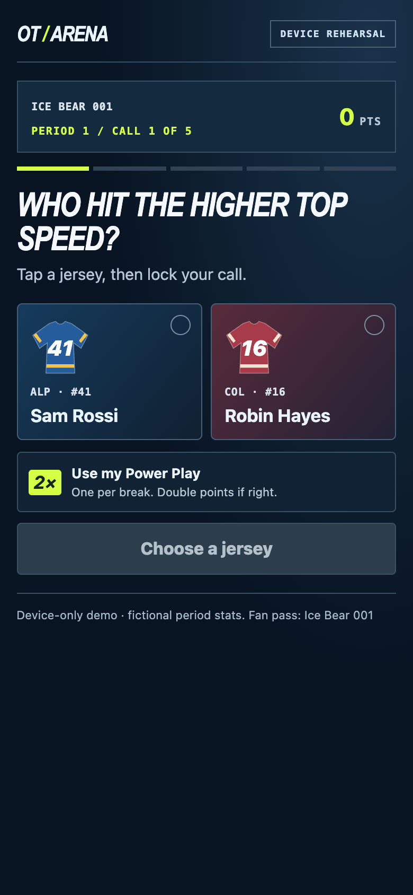
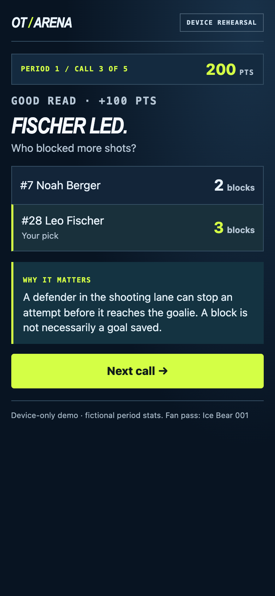

# Head-to-Head

## 1. Concept

**One QR. Two intermissions. Ten calls.** A mobile fan game for the Spengler Cup: fans compare two players using a hidden statistic from the period they just watched, then learn why that contribution matters.

## 2. Problem and audience

A recovery skate, a blocked shot or an outlet pass can be easy to miss. Raw totals need context. We want a 12-year-old newcomer and a 50-year-old regular to understand the same interaction without specialist knowledge or an advantage from fast fingers. These are design goals; audience testing remains to be done.

## 3. Match journey

At the first intermission, fans scan the arena QR and get a generated scoreboard name without signup. They make five calls. The host closes the round and the big screen shows period-one leaders.

At the second intermission, the same browser resumes the fan pass. Five new calls cover period two, followed by combined standings.

At the final horn, only fans who completed all ten calls qualify. One winner is drawn from the highest-scoring finishers. All tied top finishers have equal chances, including those outside the visible top-ten board. The winner's phone displays a private claim code for staff verification. Any real prize and its collection rules require organiser confirmation.

## 4. Interaction

Watch → choose a jersey → optionally use a Power Play → lock → see both values and the explanation.

A correct call earns 100 points. One Power Play per break doubles a correct call to 200; a wrong call earns zero. The maximum is 600 per break, 1,200 per match. There is no speed bonus; the host controls the overall break window. Large tap targets and visible feedback support play in a noisy arena without relying on sound.

## 5. Learning example

**Who blocked more shots?** The synthetic sample reveals Fischer with three blocks and Berger with two. The explanation connects the count to an action: a defender who gets into the shooting lane can stop an attempt before it reaches the goalie. A block does not establish that a goal was saved.

The fan now has something specific to watch: who closes the shooting lane when possession turns? The goal is to help them notice a contribution on the next shift. The aggregate metric does not reconstruct an actual scoring sequence.

The same care applies to other metrics: peak speed measures a burst, distance also reflects ice time and recovery skating, and pass totals alone cannot prove chance creation.

## 6. How data powers the experience

The host supplies the period's player IDs, units and values. Five comparisons use distinct players and unequal values. The host opens the break, which freezes that period's data for scoring and reveals. After each locked call, the shared backend returns its numbers and explanation.

The current public fixture is synthetic. The supplied whole-match aggregates do not establish per-period values. A real event needs authorised period snapshots, verified units and permission to display the selected values. The private host upload flow exists; automatic sports-feed ingestion does not.

The shared backend keeps future answers off the fan API and validates scoring. The public static rehearsal downloads the synthetic fixture; it is suitable for judging the interaction, not a secure prize competition.

## 7. Arena experience

The projector view displays the QR, first-break leaders, combined leaders and the final winner. The host advances stages in sequence. The draw uses unbiased cryptographic randomness and persists its result so repeated requests cannot reroll it. A private code reaches only the winning fan, and staff verify it through the host.

Fan passes identify browser entries, not unique people or tickets. For a high-value prize, the event needs agreed eligibility, ticket or identity checks and a collection process. Code verification is not an inventory or redemption system.

## 8. Spengler Cup activation proposal

| Moment | Channel and action | Purpose |
| --- | --- | --- |
| Before the match | A teaser duel on the match page and social channels | Introduce the interaction before the QR appears |
| Intermissions | Arena QR, match-page link and optional stream overlay | Let fans join in the browser without installing an app |
| After the match | Contribution recap and next-fixture invitation | Reinforce one insight and invite another match |

These channels are proposed integrations. For streaming, the operator must account for broadcast delay and eligibility. Automated social publishing and recap distribution are not built.

## 9. Feasibility and evidence

The prototype includes a plain JavaScript frontend, a persistent Node LAN server, and deployment code for a Cloudflare Worker with a SQLite Durable Object. The same rules power the shared server and local rehearsal. A protected host controls each stage and loads period packs.

On 14 November, all 34 automated tests passed across the current arena and earlier experiments. The LAN integration test passed with three independent clients, both rounds, published standings, restart recovery, host protection, a single draw from two tied leaders and private claim verification.

The public demo remains a same-browser rehearsal. Public shared hosting, authorised data integration, stadium network testing and age-group user research remain before a real event. There is no measured audience traction or demonstrated learning gain yet.

## 10. Pilot and expected impact

Hypothesis: a short data reveal helps fans recognise less visible work and gives them a reason to return for the second break and the next match.

Pilot with newcomers and regular fans across ages. Measure:

- **Join-to-finish:** first-break finishers / first-break joiners.
- **Second-break return:** first-break finishers who participate again / first-break finishers.
- **Learning recall:** ask each tester to explain one contribution and what they would watch for next.

These are proposed pilot measures, not live telemetry or claimed results. Set acceptance targets after an initial baseline test rather than inventing success percentages.

[Play](https://quentin-gigon.github.io/thinksport-hackathon/#play) · [Review source](https://github.com/Quentin-Gigon/thinksport-hackathon)

## Appendix: six judging criteria

| Official criterion | Design response | Evidence or next test |
| --- | --- | --- |
| Engagement potential | Five calls, a strategic Power Play and a second-break return | Functional loop; measure completion and return in a pilot |
| Educational value | Metric reveals explain a recognisable hockey action and its limits | Blocked-shot example; test recall with newcomers and experts |
| Creativity | Observation-based duels within a shared arena ritual | Working interaction; no unsupported claim that competitors cannot think of it |
| Clarity & feasibility | One QR, host-controlled windows and browser delivery | Implemented host flow and documented deployment path |
| Technical quality | Persistent shared scores, staged boards and one recorded draw | Rules tests, shared-event integration test and mobile captures |
| Use of data | Period values settle every call and determine the explanation | Synthetic public fixture and validated period upload contract |

No official criterion weights were supplied; this is not a predicted jury score.

## Sources and disclosures

- Organiser Deliverables page text supplied by the team on 14 November 2026: deliverables, dates, six criteria, activation expectations and confidentiality requirement.
- [Challenge website](https://tks-sic.agorize.com/en/challenges/sic-datahack-challenge-2026/pages/categories?lang=en).
- [Project source notes](../SOURCES.md), [arena rules](../../dist/arena-engine.js), and [backend documentation](../../arena-server/README.md).
- Screenshots show the team's prototype with fictional players and synthetic stats. They do not represent a real match, audience trial or official Spengler Cup deployment.
- No supplied confidential records are published. No sponsor, prize, integration agreement or age-testing result is implied.
